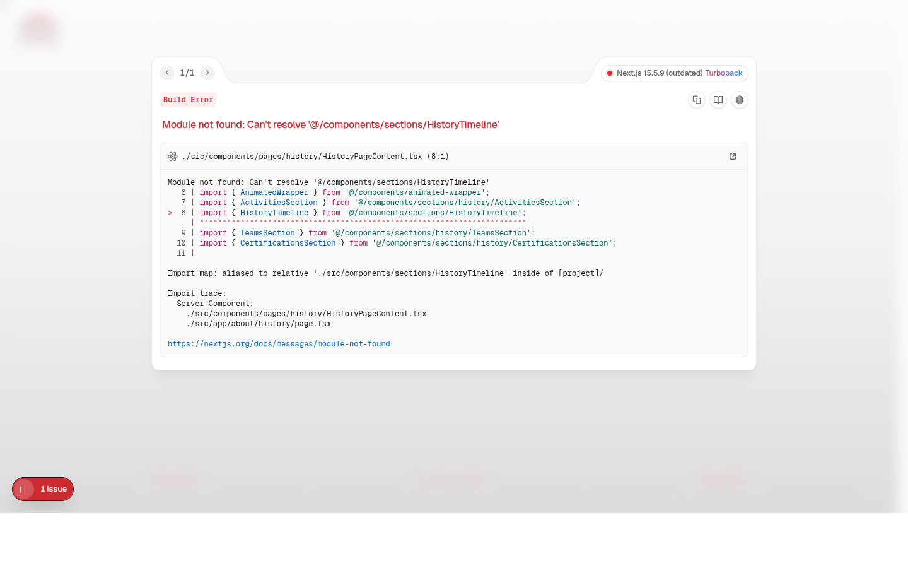

# BORDJ STEEL — Corporate Website  
**Client project · Industrial / Construction sector · Algeria**

This repository contains the source code for the **official corporate website of Bordj Steel**, a company specializing in steel construction systems and metal fabrication.

This was a **paid, professional project**, designed and built to modern standards, with a strong focus on clarity, performance, scalability, and long-term maintainability.

The website serves as Bordj Steel’s **primary digital presence** — not a demo, not a concept, but a real production-facing platform.

---

## 🧭 Project Intent

The goal of this project was to give Bordj Steel a website that:

- Clearly communicates their **industrial expertise**
- Presents complex steel products in a **structured, understandable way**
- Feels **modern, solid, and trustworthy** — not templated or generic
- Can evolve over time without collapsing under technical debt

This is not a flashy marketing toy.  
It is an **industrial-grade website**, built with the same mindset as the company’s work.

---

## 🏗️ What the Website Covers

The website is designed to showcase:

- Steel construction systems (charpente métallique, sandwich panels, galvanisation, etc.)
- Technical product variants and specifications
- Company history and positioning
- Past projects and references
- Contact and inquiry entry points

It is **purely informational and branding-oriented**.

### Explicitly out of scope
This project does **not** include:
- E-commerce
- ERP or internal business tooling
- User authentication flows
- Dashboards or admin panels

Those were intentionally excluded to keep the system focused and robust.

---

## 🧠 Source of Truth

> **This repository is the canonical source of truth for this project.**

The site was originally built in Firebase Studio, and through mid-2026 that workspace led while this repository mirrored it. That is no longer the case: the Firebase Studio workspace definition (`.idx/`) and the Firebase hosting configs (`firebase.json`, `apphosting.yaml`) were removed before delivery, because the site is not served from Firebase. Nothing outside this repository now defines the build.

Work here, and treat this tree as authoritative:
- Changes are tracked in git
- CI gates every push (build, lint, typecheck, test)
- Review happens on pull requests
- This is what gets deployed and maintained

---

## 🧩 Technology Stack

This project uses a modern, production-ready stack:

- **Framework**: Next.js 15 (App Router)
- **Language**: TypeScript
- **UI**: React
- **Styling**: Tailwind CSS
- **Component system**: shadcn/ui (Radix primitives)
- **Animations**: Framer Motion for UI motion; **anime.js** scoped to the SVG
  technical wireframes in `src/components/wireframes/` (deliberate, contained —
  see that folder's components for why)
- **Forms**: react-hook-form
- **Testing**: Vitest
- **Hosting**: served from **Netlify**. No host-specific deploy config remains in
  the repo — security headers are declared in `next.config.ts` so they apply
  regardless of which host actually serves.

The stack was chosen to balance:
- Performance
- Developer velocity
- Long-term maintainability
- Industry relevance

---

## 🧱 Architectural Philosophy

- **Server Components by default**
- Client Components only where interaction or animation is required
- Clear separation between:
  - UI components
  - Content/configuration
  - Routing
- Data-driven product rendering (no hardcoded pages per product)

The system favors **clarity over cleverness**.

A detailed breakdown lives in `ARCHITECTURE.md`.

---

## 📁 Project Structure (High Level)

```text
src/
├─ app/                  # Next.js App Router. Each page.tsx is a thin wrapper.
├─ components/
│  ├─ pages/             # One content component per route
│  ├─ sections/          # Composable page sections
│  ├─ product-variants/  # Generic, data-driven product renderer
│  ├─ wireframes/        # anime.js technical drawings (SVG)
│  └─ ui/                # shadcn/ui primitives
├─ config/               # ALL site copy and product data (the source of truth)
├─ hooks/                # Custom React hooks
└─ lib/                  # Utilities
public/
├─ media/                # All site photography (self-hosted, optimised)
├─ logos/                # Client logos
└─ documents/            # Downloadable PDFs
tests/                   # Vitest integrity suite
```

The structure is intentionally boring — boring scales.

**The rule that matters most:** user-facing text and product data live in
`src/config/**`, never inline in JSX. If you are about to type French copy into
a component, it belongs in config instead.

---

## 🖼️ Visuals (Placeholders)

> These will be added to document the final UI and structure.

```md



```

---

## 🚀 Local Development

Install dependencies:

```bash
npm install
```

Run the development server:

```bash
npm run dev
```

The app usually runs on:

```
http://localhost:9002
```

Before pushing, run the same four checks CI enforces — all must be clean:

```bash
npm run typecheck   # tsc --noEmit (strict + noUncheckedIndexedAccess)
npm run lint        # next lint
npm test            # vitest — config/asset integrity suite
npm run build       # next build (type + lint errors fail the build)
```

### The test suite

`tests/` holds **255 tests across 10 files** (`npx vitest run`, a few seconds)
that guard the failure modes this project has actually suffered, rather than
chasing coverage:

| File | Guards against |
|---|---|
| **Data integrity** — config and the `public/` asset tree, no DOM | |
| `media-integrity.test.ts` | image paths pointing at nothing; files in `public/media` that nothing references; new third-party image hotlinks creeping back in |
| `product-tables.test.ts` | spec-table header spans not matching the data (this once shipped an invalid `colSpan={0.5}`); two parts sharing one photo |
| `navigation-and-config.test.ts` | menu links to non-existent routes; unresolvable image keys; malformed contact details |
| `galvanisation-capacity.test.ts` | the three published galvanisation capacity figures drifting apart again, or a fourth appearing |
| `charpente-capacity.test.ts` | the same, for the two charpente figures |
| `chaudronnerie-cuve-geometry.test.ts` | the tank wireframe's cotes disagreeing with the table the page renders below it |
| `route-manifest.test.ts` | the hand-maintained sitemap array and `src/app/**` drifting apart; a page shipping without a `metadata` export |
| **Route** — the handler called directly, `fetch` stubbed, no network | |
| `contact-route.test.ts` | every branch that must answer without sending mail actually sending none — a swallowed message looks exactly like a 200 |
| **Component render** — jsdom | |
| `product-variant-render.test.tsx` | the generic renderer turning valid product data into broken markup, across all six live section types |
| `technical-hero.test.tsx` | the shared hero band losing its `<h1>`, its stat strip, or its media/no-media branches |

Node is the default environment (`vitest.config.mts`). The two render suites opt
into jsdom with a per-file `// @vitest-environment jsdom` pragma on line 1 and
share their stubs in `tests/support/dom-env.ts`, so they cost the Node suites
nothing. The price is four dev dependencies — `jsdom`,
`@testing-library/dom`, `@testing-library/jest-dom`, `@testing-library/react`.
End-to-end tests are a reasonable next step but are not present today.

---

## ☁️ Deployment

The site is served from **Netlify**. No Firebase or other host-specific
configuration remains in the repo: the earlier `apphosting.yaml`, `firebase.json`
and `.idx/` were removed when deployment was consolidated onto one host.

**Security and cache headers are declared in `next.config.ts`** so they ship with
the application whatever the host — verified present on the live deploy. There is
no second copy to keep in step, and `next.config.ts:7-15` asks that one not be
re-introduced.

> **Open decision:** the canonical domain is still outstanding (see *Honest
> Status* above).

---

## ⚠️ Honest Status

The codebase itself is in good shape. Four gates are green (typecheck, lint,
test, build — 36 static pages), TypeScript runs `strict` plus
`noUncheckedIndexedAccess`, there are **zero** `any` casts and zero
`@ts-ignore`, and `npm audit` reports zero vulnerabilities. All 52 findings from
the engineering audit are closed; see `KNOWN-ISSUES.md`.

**What is genuinely still open is not code — it is content and decisions.** Every
item below is put to the client as a numbered question in
`docs/CLIENT-DECISIONS.md`, which is the document to send them:

* **The live domain `bordjsteel.dz` serves an expired TLS certificate.** Visitors
  get a browser security warning before they see anything. This outranks
  everything else here.
* **The canonical domain is undecided.** `siteUrl` points at `bordj-steel.com`,
  which does not resolve to a public host, while the new site deploys to Netlify
  and `.dz` serves the old site. Every canonical/OG/sitemap URL derives from that
  one value, so it is a one-line fix once the hostname is chosen.
* **Published capacity figures contradict each other** — galvanisation appears as
  60 000, 25 000 and 20 000 T/an on different pages. Only the client can say which
  is right.
* **Missing client assets**: the three ISO certificate PDFs, a photo of the
  exterior corner piece, and the identity of the "Tazedj" client logo.
* **Image provenance**: the photography originated as Pinterest/stock URLs and is
  almost certainly not Bordj Steel's own. It is now self-hosted and fast, but
  self-hosting confers no licence — see `docs/MEDIA.md`.
* **No CMS.** All copy lives in typed config, so every text change needs a
  developer and a redeploy. Defensible at this size; the first thing to revisit
  if the client wants to edit their own content.

Nothing here is hidden behind a build flag — `next.config.ts` deliberately does
not suppress type or lint errors.

---

## 🧹 Editing Rules (Read This First)

* Do not introduce parallel product systems
* Do not normalize or rewrite product content unless restoring it verbatim
* Prefer deleting or archiving legacy code over keeping hybrids
* Stability beats novelty

This is a **real client project**, not a sandbox.

---

## 📚 Documentation

* `README.md` — project overview (this file)
* `ARCHITECTURE.md` — technical structure and decisions
* `CLAUDE.md` — contributor / agent guide (commands, conventions, editing rules)
* `KNOWN-ISSUES.md` — the defect register: what was found, what was fixed, what is still blocked on the client
* `docs/CLIENT-DECISIONS.md` — the questions the client must answer before launch (domain, fire class, capacity figures, files), written in French and addressed to them
* `docs/MEDIA.md` — the image pipeline (self-hosting, AVIF, how to add a photo)
* `docs/COPY-TYPOGRAPHY-REVIEW.md` — the apostrophe inventory behind `DELIVERY-PLAN.md` T4-5
* `DELIVERY-PLAN.md` — the pre-delivery plan: what is done, what is blocked on the client
* `docs/archive/` — point-in-time records, each kept only because it preserves a fact recorded nowhere else. **None of it is current guidance** — see `docs/archive/README.md`, which says per file what survives and why.

---

## Final Note

This repository represents **professional work delivered to a real company**.

Every decision here was made with:

* Constraints
* Deadlines
* Maintainability
* And future developers in mind

If you’re reading this as a developer:
this is meant to be understandable.

If you’re reading this as a client:
this is meant to last.

